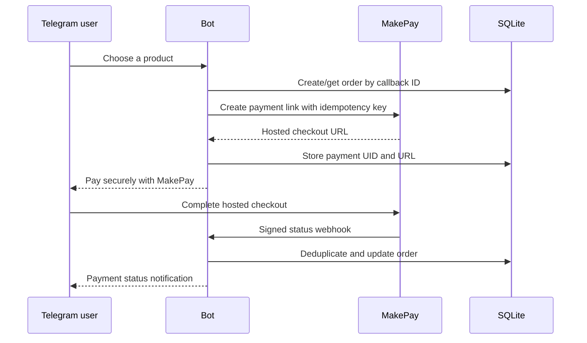

# MakePay Telegram Bot

An open-source, production-minded starter for accepting cryptocurrency payments
from a Telegram bot with [MakePay](https://www.makepay.io/).

The bot presents a small product catalog, creates an idempotent MakePay payment
link, and sends the buyer to MakePay's hosted checkout. Signed MakePay webhooks
and background reconciliation update a durable local order record and notify the
buyer in Telegram.

> This repository accepts payments; it does not implement product fulfillment.
> Connect your own fulfillment only after an order reaches the local `paid`
> state.

## Why this starter

- The bot never receives cryptocurrency, seed phrases, or private keys.
- Telegram and MakePay webhooks are independently authenticated.
- Payment-link creation is idempotent, so Telegram retries cannot create
  duplicate checkouts.
- SQLite stores orders, webhook deduplication keys, and a retryable notification
  outbox.
- A reconciliation worker recovers status changes if a webhook is delayed or
  missed.
- The container runs as a non-root user and exposes health/readiness endpoints.
- Tests cover input validation, order transitions, webhook signatures,
  credential isolation, and API behavior.

## Payment flow



See [the architecture notes](docs/architecture.md) for state transitions,
failure handling, and scaling guidance.

## Quick start with Docker

You need:

- a Telegram bot token from [@BotFather](https://t.me/BotFather);
- a public HTTPS URL pointing to this service;
- a MakePay API key ID and secret;
- the MakePay webhook signing secret configured for your callback.

Clone the repository and create your environment file:

```bash
git clone https://github.com/makepay-io/makepay-telegram-bot.git
cd makepay-telegram-bot
cp .env.example .env
openssl rand -hex 32
```

Put the generated value in `TELEGRAM_WEBHOOK_SECRET`, fill the other values in
`.env`, and edit `catalog.json`. Then start the bot:

```bash
docker compose up --build
```

The service registers its Telegram webhook on startup. In MakePay, set the
company webhook/callback URL to:

```text
https://YOUR_PUBLIC_HOST/webhooks/makepay
```

Store the associated signing secret as `MAKEPAY_WEBHOOK_SECRET`. Do not reuse
the Telegram secret or your MakePay API secret.

Open the bot in a private Telegram chat and send `/shop`.

## Local development

Use Python 3.12 or newer:

```bash
python -m venv .venv
source .venv/bin/activate
python -m pip install -e '.[dev]'
cp .env.example .env
set -a
source .env
set +a
makepay-telegram-bot serve --port 8000
```

Telegram and MakePay require a public HTTPS callback, so expose port `8000`
through the tunnel or ingress of your choice and set `PUBLIC_BASE_URL` to that
origin. Plain HTTP is accepted only for `localhost` when
`ALLOW_INSECURE_LOCALHOST=true`.

Useful commands:

```bash
makepay-telegram-bot set-telegram-webhook
makepay-telegram-bot delete-telegram-webhook
pytest --cov --cov-report=term-missing
ruff check .
ruff format --check .
mypy
pip-audit
```

## Configure the catalog

`catalog.json` is intentionally simple:

```json
[
  {
    "id": "coffee",
    "name": "Coffee voucher",
    "description": "A demo voucher fulfilled by the merchant after payment.",
    "amount": "5.00",
    "fiatCurrency": "USD"
  }
]
```

Rules:

- `id` must be 1–32 lowercase letters, numbers, `_`, or `-`;
- `amount` must be a positive decimal string with at most two decimal places;
- `fiatCurrency` must be a three-letter ISO code;
- the configured MakePay account controls settlement assets and addresses.

Restart the service after changing the catalog.

## Environment variables

| Variable | Required | Purpose |
| --- | --- | --- |
| `TELEGRAM_BOT_TOKEN` | Yes | Token issued by BotFather |
| `TELEGRAM_WEBHOOK_SECRET` | Yes | Random secret Telegram sends in its webhook header |
| `PUBLIC_BASE_URL` | Yes | Public HTTPS origin, without a path |
| `MAKEPAY_KEY_ID` | Yes | MakePay/MakeCrypto API key identifier |
| `MAKEPAY_KEY_SECRET` | Yes | MakePay/MakeCrypto API key secret |
| `MAKEPAY_WEBHOOK_SECRET` | Yes | Secret used to verify `x-makepay-signature` |
| `MAKEPAY_API_BASE_URL` | No | Defaults to `https://www.makecrypto.io` |
| `MAKEPAY_CHECKOUT_BASE_URL` | No | Defaults to `https://www.makepay.io` |
| `DATABASE_PATH` | No | Defaults to `./data/bot.db` |
| `CATALOG_PATH` | No | Defaults to `./catalog.json` |
| `RECONCILE_INTERVAL_SECONDS` | No | Status recovery interval; default `60` |
| `NOTIFICATION_INTERVAL_SECONDS` | No | Outbox retry interval; default `10` |
| `MAX_WEBHOOK_BODY_BYTES` | No | Request limit; default 1 MiB |
| `LOG_LEVEL` | No | `DEBUG`, `INFO`, `WARNING`, `ERROR`, or `CRITICAL` |

`ADMIN_TELEGRAM_USER_IDS` is reserved for merchant extensions. The starter does
not expose buyer or order administration through Telegram.

## Webhook behavior

- Telegram requests must contain the exact
  `x-telegram-bot-api-secret-token`.
- MakePay signatures cover `timestamp + "." + exact_raw_body` using HMAC-SHA256.
- MakePay timestamps have a five-minute tolerance.
- `x-makepay-delivery-group-id` is the preferred deduplication key; older
  deliveries fall back to `deliveryId`.
- Unknown but valid MakePay events are acknowledged without changing an order.
- A `paid` order never downgrades. A late confirmed payment may recover an
  earlier failed or expired order.

## Production checklist

- Run exactly one replica while using SQLite.
- Mount `/app/data` on persistent storage and back it up.
- Terminate TLS at a trusted ingress and forward only to the container port.
- Restrict secret access to the service and rotate credentials after exposure.
- Configure MakePay settlement assets and addresses before taking live orders.
- Test the complete payment and refund/support journey with a low-value order.
- Replace the sample catalog and connect idempotent fulfillment to the `paid`
  transition.
- For multiple replicas, move orders, webhook deduplication, and the outbox to
  Postgres and use row-level work claiming.

The public HTTP endpoints are:

- `GET /healthz` — process liveness;
- `GET /readyz` — database and Telegram application readiness;
- `POST /webhooks/telegram` — authenticated Telegram updates;
- `POST /webhooks/makepay` — signed MakePay events.

## Security

Please read [SECURITY.md](SECURITY.md) before reporting a vulnerability. The bot
deliberately avoids logging payloads, checkout URLs, user IDs, and secrets.

## License

[MIT](LICENSE)

