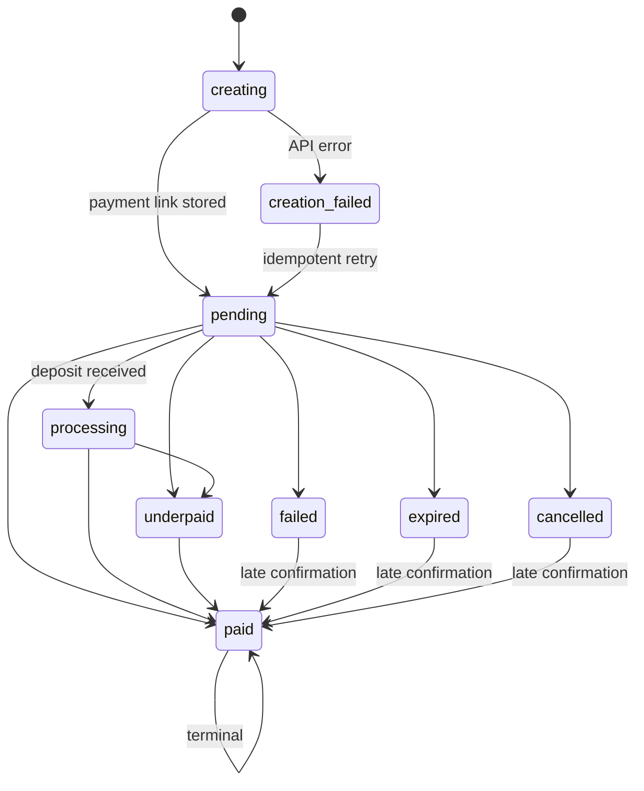

# Architecture

## Scope

The starter demonstrates the payment boundary of a Telegram commerce bot:
catalog selection, MakePay checkout creation, authenticated status ingestion,
local order state, and buyer notifications. Inventory, taxes, refunds,
fulfillment, and merchant administration are intentionally outside its scope.

## Trust boundaries

1. Telegram is trusted only after the secret-token header matches.
2. MakePay is trusted only after its timestamped HMAC signature verifies
   against the exact raw request body.
3. A signed MakePay event is correlated to an existing local order by payment
   UID or the random UUID sent as `orderId`.
4. Hosted checkout URLs come only from the authenticated MakePay API response
   or the configured MakePay checkout origin.
5. Buyers can inspect only orders matching both their Telegram user ID and chat
   ID.

Telegram identity is never sent to MakePay. MakePay receives the random local
order ID and non-sensitive integration metadata.

## Order state

Unknown MakePay states conservatively map to `pending`. A terminal state does
not regress, except any state may advance to `paid`.

## Idempotency and delivery

- Telegram callback query IDs have a unique constraint, so a retried update
  loads the original order.
- The MakePay request uses `telegram-{order UUID}` as its `Idempotency-Key`.
  Retries send the same body with the same key.
- Webhook retries use `x-makepay-delivery-group-id` as the unique key. Legacy
  deliveries use `deliveryId`; a final body hash fallback protects very old
  payloads.
- Order updates and notification creation occur in one SQLite transaction.
- Telegram notification delivery is at least once internally and effectively
  once after `sent_at` is stored. A process crash immediately after Telegram
  accepts a message can produce a duplicate message; order state remains
  correct.

## Recovery

The reconciliation worker reads MakePay's public current-session endpoint for
non-terminal orders. This covers a missing webhook and drives the same
transactional update path. Manual “Check payment status” actions use the same
mechanism.

## Deployment model

SQLite WAL mode is appropriate for a single process with a persistent volume.
Do not run multiple replicas against one SQLite file on network storage.

For horizontal scaling, replace `Database` with Postgres and:

- preserve unique constraints on request and webhook deduplication keys;
- claim outbox rows with `FOR UPDATE SKIP LOCKED`;
- run migrations separately from application startup;
- add bounded retries and dead-letter monitoring;
- rate-limit reconciliation per MakePay account.

